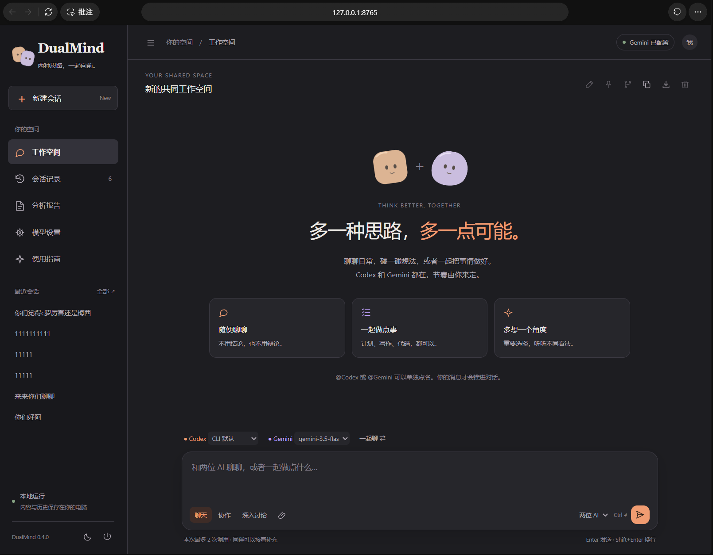

# DualMind

**多一种思路，多一点可能。**

<p align="center">
  <a href="README.md#简体中文">简体中文</a> · <a href="README.md#english">English</a> · <a href="README.md#español">Español</a>
</p>

[](https://github.com/Xwc18779517894/DualMind/actions/workflows/tests.yml)   [](LICENSE)

和一个 AI 聊天，能帮助我们整理想法；把另一个 AI 放进同一段对话，可能发现遗漏的前提、不同的路线和更值得问的问题。**DualMind 是你、Codex 和 Gemini 的本地共同工作空间**，可以聊日常、一起做事，也可以在重要问题上认真交换看法。

它不会为了辩论而强行反对，也不把两个模型的一致意见当成事实。对话由你的消息推进。



*截图由作者提供，展示实际应用的空白工作空间。当前界面为中文，项目介绍提供中、英、西三种语言。*

## 已有功能

| 功能 | 使用方式 |
|---|---|
| 自然群聊 | 默认两位 AI 回答，第二位可以接着第一位补充，不套“立场、论据、假设”模板。 |
| 各自思考 | 切换“各自回答”，同轮互不影响；两种方式都最多两次调用。 |
| 共同工作 | 计划、写作、方案评审、产出代码；点名一位继续做。 |
| 深入讨论 | 第一轮独立思考，随后交换具体看法，最后生成五部分报告。 |
| 会话管理 | 全文搜索、置顶、改名、复制会话、删除到回收站、恢复。 |
| 修改与重试 | 编辑消息或重新生成会创建分支，保留原会话；重试只调用选中的 AI。 |
| 模型切换 | 获取 Gemini 模型列表，选择或手填；Codex 保留 CLI 默认，也支持指定模型。 |
| 舒适阅读 | 暖白、墨灰与跟随系统主题；橙紫高亮；正文和输入框共用居中宽度。 |
| 日常细节 | 草稿自动保存、@点名、快捷键、文本文件上下文、代码复制和 Markdown 导出。 |

## Windows 快速开始

### 1. 准备环境

- 安装 [Python 3.11 或更新版本](https://www.python.org/downloads/windows/)，本机验证版本为 3.13.2。
- 安装官方 [Codex CLI](https://developers.openai.com/codex/cli/) 并登录有使用资格的 ChatGPT 账号。npm 安装方式需要 [Node.js LTS](https://nodejs.org/)。
- 从 [Google AI Studio](https://aistudio.google.com/apikey) 获取 Gemini API Key。

```powershell
npm install -g @openai/codex
codex login
git clone https://github.com/Xwc18779517894/DualMind.git
cd DualMind
```

也可以在 GitHub 点击 Code → Download ZIP，解压后打开项目文件夹。

### 2. 安装 Python 依赖

双击 `setup.cmd`，会创建项目内的 `.venv` 并安装依赖。也可以手动执行：

```powershell
py -3 -m venv .venv
.\.venv\Scripts\python.exe -m pip install -r requirements.txt
```

前端是原生 HTML/CSS/JavaScript，没有构建步骤、Electron 或云服务。Python 必需依赖只有 `google-genai`；前端不需要 Node，但 npm 安装 Codex CLI 需要。

### 3. 启动并配置模型

1. 双击 **启动DualMind.cmd**：独立应用窗口；或 **浏览器打开DualMind.cmd**：普通浏览器标签页。
2. 在“模型设置”粘贴 Gemini Key 并保存。输入框留空表示保留已有 Key，保存不会生成回答。
3. 选择 Gemini 模型；默认 `gemini-3.5-flash-lite` 曾在开发账号的一次短请求中成功，其他账号的可用性、配额和费用需自行确认。
4. Codex 模型留空使用 CLI 当前默认；可手填模型名或参考本机 CLI 缓存候选。候选不保证当前账号有权限。
5. 第一次先只选 Gemini 发送一句短消息，确认连接，再让两位一起参与。

命令行启动方式：

```powershell
.\.venv\Scripts\python.exe dualmind_web.py --browser
```

服务优先使用 `http://127.0.0.1:8765/`，端口被占用时会换一个可用端口；实际地址在设置页显示。收藏的网址需要本地服务先运行。关网页不等于立即关服务，可点“退出应用”，或等待约三分钟空闲退出。

## 聊天方式与快捷操作

- **聊天**自然接话；**协作**一起产出有用结果；**深入讨论**才会多轮交流并生成报告。
- **一起聊**：第二位能看到第一位本轮回复；**各自回答**：双方基于同一历史独立回答。两者都不会无限自动聊天。
- 消息开头输入 `@Codex` 或 `@Gemini`，可以单独点名；也可以用输入框旁的选择器。
- Enter 发送，Shift+Enter 换行，Ctrl+Enter 也能发送；输入法选词时不会发送。
- Ctrl+Shift+O 新会话，Ctrl+K 打开历史搜索。
- 可添加或拖入 UTF-8 文本/代码文件，单文件最多 64 KB，整条消息最多 12000 字。本版不解析图片或 PDF。
- 会话编辑和重新生成会创建新分支，不覆盖原会话。删除可在回收站恢复。

### 调用次数与边界

单独点名最多 **1 次**生成；两位最多 **2 次**；深入讨论为 **2 × 轮数 + 1 次**，支持 1～3 轮。获取模型列表会请求 API 元数据，不生成文本。没有自动重试、无限循环或隐藏的付费模型回退。

应用不额外开通收费账号或计费，但不保证 API 免费：Codex 消耗已有账号额度，Gemini 受实际项目配额和计费规则约束。上下文携带最近 12 条、约 16000 字；长任务请重申重要背景。

最后的报告由 Gemini 汇总，区分双方共识、核心分歧、各方论据、证据不足和可执行建议；它不是独立事实核查。当前协作能产出文本、方案和代码，不提供通用的自主文件修改。回复在各模型完成后显示，尚无逐 token 流式输出。

## 代理与常见错误

“模型设置 → 本地代理”可填写本机 HTTP/混合代理，如 `http://127.0.0.1:7897`，只影响 Gemini，保存立即生效。不修改系统代理、Codex 网络或证书验证。

请以代理软件实际端口为准；留空使用启动环境，也支持 `DUALMIND_GEMINI_PROXY`。备用 Clash 启动器使用 7897，如果端口不同需修改。首次网络配置、地区条件和路由仍须符合服务支持要求。

| 错误 | 处理方法 |
|---|---|
| Key 未配置 | 在应用里保存 Key，或启动前设置 `GEMINI_API_KEY`。PowerShell 临时变量不会被 Explorer 双击继承。 |
| 400 地区不支持 | 检查实际出口和 [Gemini 支持地区](https://ai.google.dev/gemini-api/docs/available-regions)；换模型不能保证解决。 |
| 404 模型不可用 | 部分模型虽然列出，但已退役或未向账号开放；选择其他支持文本生成的模型。 |
| 429 配额/频率限制 | 查看 API 项目用量，稍后再试，避免反复同时调用两位。 |
| 503 high demand | 当前模型繁忙，稍后只重新生成 Gemini，或明确选择另一可用模型。 |
| 断连/超时 | 检查网络、代理分流和超时；不能仅凭网络错误判断 Key 无效。 |
| Codex 不可用 | 在终端检查 `codex --version` 和 `codex login`；旧 CLI 不支持临时会话参数时更新官方 CLI。 |
| 后端更新未生效 | 任务完成后退出应用再启动；只刷新网页不会重新加载 Python。 |

## 本地数据与密钥

新安装默认存放于 `%LOCALAPPDATA%\DualMind`；原型用户的旧目录存在时继续使用，避免历史丢失。可用 `DUALMIND_DATA_DIR` 覆盖位置。

```text
数据目录/
  history/          会话与报告 JSON
  trash/            可恢复的已删除会话
  settings.json     模型、互动方式与超时
  gemini-key.dpapi   Windows 用户绑定的加密 Key
  server.json       本地运行信息，不能公开分享或提交
```

页面不回显已保存的密钥；Key 不写源码、普通设置或模型日志。DPAPI 密文不能直接搬到另一个 Windows 用户。历史、回收站和浏览器草稿是本地明文，聊天中不要粘贴秘密。

本地保存不意味着离线推理：发送的消息会交给所选模型提供方。服务只绑定 localhost，不应暴露到公网。详见 [安全与隐私说明](SECURITY.md)。

## 开发与验证

```powershell
.\.venv\Scripts\python.exe -B -m unittest test_dualmind test_dualmind_web -v
node --check frontend/app.js
node --check frontend/theme.js
```

自动测试模拟所有模型，不消耗真实 AI 额度。`test_gemini.py` 是手动运行才发请求的真实短测脚本；导入不会调用模型。CI 在 Windows 运行离线测试。浏览器验证覆盖深浅主题、全屏、窄窗、短窗、草稿、模型选择与会话管理；模拟界面不代表真实模型质量。

阅读 [架构说明](docs/architecture.md)、[变更日志](CHANGELOG.md)、[贡献指南](CONTRIBUTING.md)。旧 CLI/Tkinter 入口保留，主要维护界面为 Web 工作空间。

## 参考与致谢

参考 [LibreChat](https://github.com/LibreChat-AI/LibreChat) 和 [Open WebUI](https://github.com/open-webui/open-webui) 的会话管理、模型控制和文档组织；视觉上参考 Codex/Claude 的克制工作台。两位小角色和界面实现为原创，Claude 仅是视觉参考，当前实际接入为 Codex + Gemini。

使用官方 [Google Gen AI SDK](https://github.com/googleapis/python-genai) 与 [Codex CLI](https://developers.openai.com/codex/cli/reference/)。各模型品牌归对应所有者。源码采用 [MIT 许可](LICENSE)。
